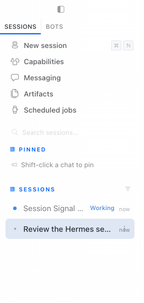
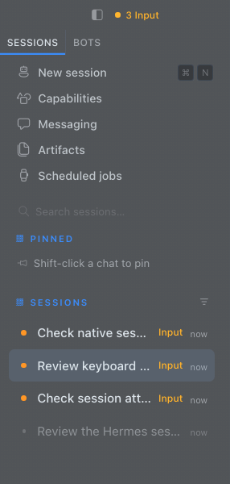

# Session Signal

T3 Code inspired session rows for Hermes Desktop. See what is working, what needs input, and what finished while you were elsewhere.

**v0.2.0 · experimental · manual install · MIT**

 

Actual Hermes UI, captured in isolated demo sessions. The automated demo uses local mock inference and real gateway events; it does not use personal session history.

## What it does

- Slim 36px Compact rows, 14px titles, a native status dot, and plain Working, Background, Input, and Done labels.
- Working and background sessions dim to 70%; idle and draft sessions dim to 55%. Hover, keyboard focus, and selection restore full visibility.
- Input and Done counts in the titlebar cycle through matching mounted sessions in sidebar order.
- Comfortable, Detailed, and Inbox layouts keep their native row heights and metadata. Native menus, pinning, grouping, and navigation stay in Hermes.

Opening Done acknowledges Hermes's unread state. Opening Input leaves the request pending until answered. Done means an unread completion, not a verified successful task.

## Install

Requires Hermes Desktop with the [local desktop plugin SDK](https://github.com/NousResearch/hermes-agent/blob/main/website/docs/developer-guide/desktop-plugin-sdk.md). Tested on macOS with an installed **local Hermes build**, stamped at commit `77e2992020eafded09e0c344e687ae53e52e6eab` with local modifications. Its UI reported `v0.21.5+4701`; the app bundle's version fields are `0.0.0`. This is a tested local build, not a certified public-version support range. Stock release builds, other versions, and other operating systems have not been verified.

1. Download and extract the release ZIP. You only need `desktop/plugin.js`; no build or npm install is required.
2. In your Hermes home, create `desktop-plugins/hermes-session-signal/`. The default full destination is `~/.hermes/desktop-plugins/hermes-session-signal/plugin.js`. If you use a custom `HERMES_HOME`, use that directory instead. Keep a backup of an existing Session Signal file before replacing it.
3. Copy this release's `desktop/plugin.js` to that destination, keeping the file name `plugin.js`.
4. In Hermes, open **Capabilities → Plugins → Rescan** and enable **Session Signal**. Reopen Hermes if it does not appear.

The only runtime imports are `@hermes/plugin-sdk` and React, supplied by Hermes.

### Disable or remove

Turn off **Session Signal** in **Capabilities → Plugins**. The labels, attention strip, stylesheet, and plugin-owned row attributes are removed. Re-enabling restores the current state.

To uninstall, disable it first, then remove only the `plugin.js` file you installed in `desktop-plugins/hermes-session-signal/`. Rescan or reopen Hermes. Your sessions are owned by Hermes and are not stored by this plugin.

## Compatibility and scope

Session Signal uses the SDK's session-row and titlebar contribution areas. It also reads the native status dot's localized accessible label and styles the native row DOM because the resolved status map is not exposed by the SDK. This depends on `.row-hover`, `.hover-marquee`, the selected-row class, status labels, and `host.settings` density reads. A Hermes update can change that contract. Disable the plugin if rows misbehave, and rerun verification before declaring a new version supported.

This is an unofficial local disk plugin. It has not been admitted to the Hermes plugin catalog. It is not affiliated with Nous Research or T3 Tools.

Counts include **mounted sidebar sessions only**. Collapsed groups, filtered-out rows, unloaded history, and Bot Mode roster rows are excluded. Hermes combines approvals and clarify requests into Input. Labels added by Session Signal are currently English; native state detection follows Hermes's translated labels.

Snooze/wake and an elapsed Working timer are not included in v0.2.0.

## Data behavior

The plugin keeps a transient map of mounted row identifiers, status, and DOM elements. It adds no model calls, network requests, telemetry, backend changes, or new persistent session storage. Clicking an attention count uses Hermes's native row action, including its normal unread acknowledgment.

Like other local disk plugins, it runs inside the Hermes renderer. Review the source before installing. Avoid combining it with another plugin that overrides session-row geometry or opacity.

## Development and verification

Use Node.js 22 or newer. `npm run check` validates plugin and verifier syntax without installing dependencies. The included GitHub workflow runs this syntax check only.

The full UI test requires macOS, `/Applications/Hermes.app`, and a compatible [Hermes source checkout](https://github.com/NousResearch/hermes-agent) with its JavaScript test dependencies and Python environment already installed using Hermes's own setup instructions. The source/test baseline used here was `77e2992020eafded09e0c344e687ae53e52e6eab`. The checkout must provide `tsx`, `@playwright/test`, `tests-js/scripts/mock-server.ts`, `mock-provider-config.ts`, and `desktop-chat-smoke.ts`. This is a developer test setup; regular installation does not need it.

From the extracted project directory:

```sh
npm run check
SIGNAL_HERMES_ROOT=/absolute/path/to/hermes-agent npm test
```

Without `SIGNAL_HERMES_ROOT`, the verifier uses `~/.hermes/hermes-agent`. Set `SIGNAL_EVIDENCE_DIR` to change the output directory; the default is `evidence/`.

The test launches the installed app with a separate Hermes home and Electron user-data directory, an isolated backend, and local mock inference. It strips provider credentials from the child environment and disables lazy installs. It exercises Working, background dimming, unread completion, three simultaneous Input requests, navigation wraparound, title truncation, keyboard focus, native menus, all three densities, Inbox, both color modes, and disable/re-enable cleanup. It closes its own app and mock server and removes its own temporary sandbox. If source bootstrap temporarily repins shared launchers into that sandbox, the verifier restores only those repins.

The [verification receipt](docs/verification.json) records the release check. The developer [verification skill](.agents/skills/verify-session-signal/SKILL.md) maps the UI journey. Mock inference validates UI integration and event transitions; it does not establish production model/provider behavior.

## Credits

Inspired by [T3 Code](https://github.com/pingdotgg/t3code), especially its [sidebar presentation](https://github.com/pingdotgg/t3code/blob/50647de0143e68fde051eb1a0ccf4fe63f9947b2/apps/web/src/components/Sidebar.tsx) and [status logic](https://github.com/pingdotgg/t3code/blob/50647de0143e68fde051eb1a0ccf4fe63f9947b2/apps/web/src/components/Sidebar.logic.ts), inspected at commit `50647de0143e68fde051eb1a0ccf4fe63f9947b2`. See [third-party notices](THIRD_PARTY_NOTICES.md) for the upstream MIT notice.

Session Signal is licensed under [MIT](LICENSE).
